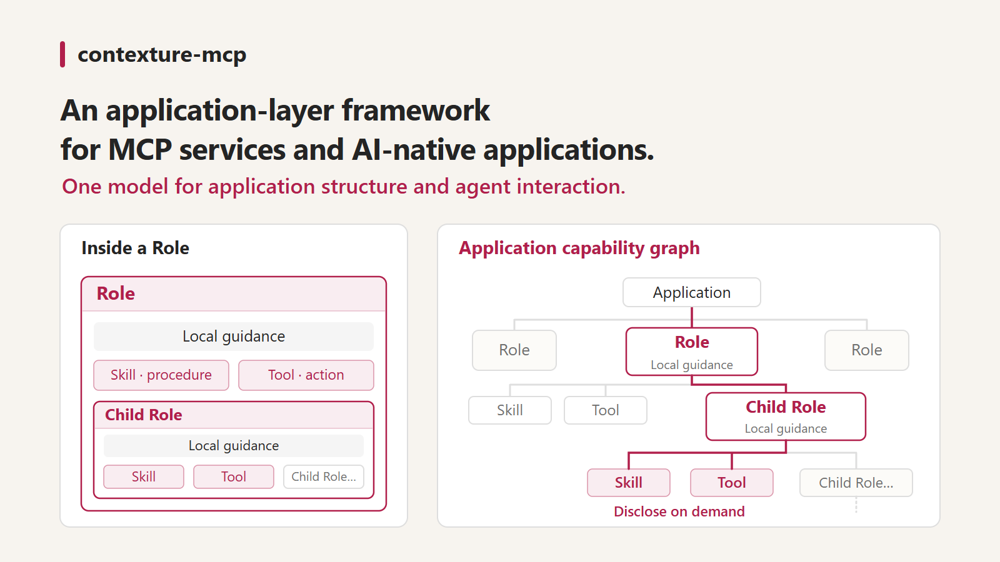

# 一套模型，连接应用结构与 Agent 交互

[English](design.md) · [文档导航](README.zh-CN.md) · [中文手册](handbook.zh-CN.md)

Contexture 是应用层 Controller 框架。核心选择是用同一套能力声明组织应用，
并生成 Agent 可以导航的接口。渐进披露是这种结构带来的能力之一，不是框架
全部的目的。

## 应用设计的问题

MCP 标准化了访问工具和数据的方式。不断增长的应用仍需要设计职责边界、
可复用过程、可执行动作，以及 Agent 在各个领域接收什么指导。
这些是应用设计问题，不是 MCP 协议的缺陷。

如果关系只存在于分别维护的描述和提示中，变更就更难追踪和检查。Contexture
将它们显式写在应用代码里，但不把业务逻辑或授权迁移进一个新的 Agent 运行时。

## 封装职责，组合能力

- **Role** 命名职责，持有局部指令、Skill、Tool 和子 Role。子 Role 表达更具体的职责。
- **Skill** 描述模型遵循的过程；`uses` 引用将过程连接到已有能力，
  它不是可执行的工作流代码。
- **Tool** 将可执行处理函数与带类型的输入 Schema 绑定，可以调用已有服务，
  而不重复实现领域逻辑。
- **包含关系**确定归属和规范路径；**`uses`** 记录显式引用，不调度调用、
  不提供重试或事务。包含是组合，不是指令继承。

编译器构建不可变图，检查声明关系与绑定。编译后的模型同时支持面向 Agent
的披露内容，以及解析并调用 Tool 的运行时。

## Agent 接收什么

| 交互 | 承担的职责 | 不会做的事情 |
| --- | --- | --- |
| Discover | 返回起点卡片 | 加载整张图的指令 |
| Inspect | 比较候选导航卡片 | 激活指令或暴露 Tool Schema |
| Open | 披露局部指导和能力卡片；打开 Skill 可获得过程和声明引用 | 执行业务代码 |
| Invoke | 经对应的读写入口解析、验证并执行 Tool | 强制执行 Skill 的每条指令 |

打开 Role 会返回下一层成员；Tool 卡片包含调用所需的 Schema。Agent 可以选择
相关分支，而不打开无关细节。这不是强制状态机：调用已知 ref 不要求先 open。
打开节点不会自动继承祖先指令，也不会清除 Host 上下文中的已有内容。
披露不等于授权。

## 为什么有助于开发和维护

目标是在应用演进过程中，让职责边界、可复用指导和可执行能力保持在一起：

- 增加或调整过程时引用已有 Tool，不必把实现复制到另一套集成中。
- 查看由实际编译声明生成的上下文，而不是另外维护一份手写导航目录。
- 从同一个带类型的处理函数生成 Tool Schema 并验证调用。
- 通过显式 REST 路由暴露选定 Tool，共用运行时，同时保留业务服务的逻辑与授权。

这些是具体机制，不是已测量的工时或 ROI 收益。图校验检查结构，不证明指导文字
或模型判断正确。引用使用显式路径：移动能力时可能需要同步调整 `uses` 和调用方。
继续阅读已有的[能力扩展指南](handbook.zh-CN.md#6-把能力放在正确位置)。

## 与其他 MCP 框架的关系

[FastMCP](https://gofastmcp.com/servers/composition) 支持服务组合、
[以资源提供 Skills](https://gofastmcp.com/servers/providers/skills)，以及
[按需工具搜索](https://gofastmcp.com/servers/transforms/tool-search)。
[mcp-use](https://github.com/mcp-use/mcp-use) 支持 MCP 服务和应用的构建与集成；
[FastAPI-MCP](https://github.com/tadata-org/fastapi_mcp) 复用已有 FastAPI 端点。
它们提供了有用的基础，不能被简化为“只能暴露无结构函数列表”的弱对照。

Contexture 的具体架构选择，是用递归的职责、过程和动作模型，统一支持组合、
引用检查、导航、指导披露和 Tool 调用。其他框架也可以构建类似行为；Contexture
将这一整合模型作为默认编写方式。它不宣称 OOP、模块化、服务复用或渐进披露
是其独有能力。

## 何时选择，以及何时不需要

当应用中的多个职责需要各自的指导和可复用能力，或者开发者希望将一个显式模型
的结构与 Agent 接口一起检查时，可以考虑 Contexture。

对于少量独立动作，直接暴露 MCP 工具可能更简单。只需要解决发现问题时，
Host 工具搜索可能已经足够。需要由代码强制顺序、重试或事务时，应考虑工作流引擎。

代价同样存在：导航增加往返；描述和 Skill 需要认真编写；固定网关让业务工具
名称和 Schema 不出现在 MCP 顶层列表中。因此，Host 若要实施逐业务工具搜索或
审批策略，可能需要理解 ref 的集成。读写双入口有助于分类，但不替代业务授权。

先体验[确定性 Demo](../contexture/demo/README.zh-CN.md)，再按[手册](handbook.zh-CN.md)
构建自己的应用。未来可视化与评估工作独立记录在[路线图](roadmap.zh-CN.md)中。
